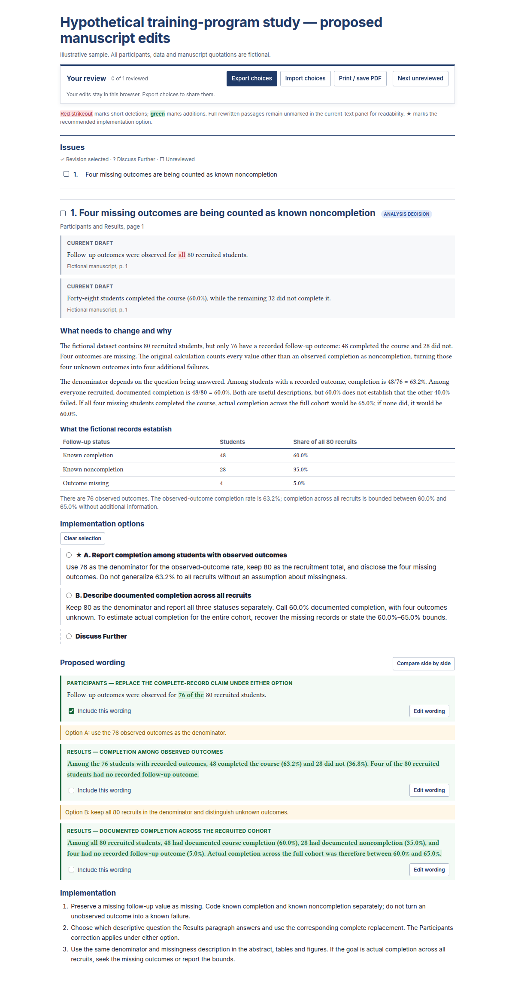

# paper-review

A shared skill for **Codex and Claude Code** that reviews empirical manuscripts, revisions and proofs, reproduces analyses when materials are available, and turns findings into concrete edits for coauthors.

Each issue shows the current manuscript wording, explains the problem in plain language, supplies a complete proposed replacement, and identifies implementation choices and any work still required. The report uses gray source panels, red deletions, green additions, recommendation markers and explicit prerequisites. It focuses on issues needing attention, with an independent reader pass for substantive findings.

## Sample report

This fully fictional training-program example distinguishes missing outcomes from known noncompletion. It shows why **48/76 = 63.2%** and **48/80 = 60.0%** answer different questions, then provides wording for each approach. All data and quotations are hypothetical.

[View the sample PDF](examples/sample-report.pdf) · [Download the report HTML](https://raw.githubusercontent.com/dhagmann/paper-review/main/examples/sample-report.html) · [Inspect the report input](assets/example-review.json)

Download the HTML and open it in a browser to try the review controls. The PDF is the printable version.



## Install

One copy works with both tools. Their shared `SKILL.md` format needs no separate Claude version; `agents/openai.yaml` supplies optional Codex interface metadata.

Clone the repository once:

```bash
mkdir -p "$HOME/.local/share/agent-skills"
git clone https://github.com/dhagmann/paper-review.git "$HOME/.local/share/agent-skills/paper-review"
```

Register it with either or both tools. These commands assume the destination skill does not already exist.

**Codex:**

```bash
mkdir -p "$HOME/.agents/skills"
ln -s "$HOME/.local/share/agent-skills/paper-review" "$HOME/.agents/skills/paper-review"
```

**Claude Code:**

```bash
mkdir -p "$HOME/.claude/skills"
ln -s "$HOME/.local/share/agent-skills/paper-review" "$HOME/.claude/skills/paper-review"
```

These are personal skill locations, available across projects on that machine. Both tools support symlinked skill folders. See the official [Codex skill locations](https://developers.openai.com/codex/skills/#where-to-save-skills) and [Claude Code skill locations](https://code.claude.com/docs/en/skills#choose-where-skills-load). For Windows, use these shell commands in WSL, or copy the folder into the corresponding personal skill directory.

To update the shared copy:

```bash
git -C "$HOME/.local/share/agent-skills/paper-review" pull --ff-only
```

## Use

In **Codex**:

```text
$paper-review Review manuscript.pdf against the data and analysis scripts in this project. Reproduce the reported results where possible and prepare a PDF/HTML report with concrete revisions.
```

In **Claude Code**:

```text
/paper-review Review manuscript.pdf against the data and analysis scripts in this project. Reproduce the reported results where possible and prepare a PDF/HTML report with concrete revisions.
```

Specify the manuscript version, available materials and review scope. The skill distinguishes exact reproduction from independent reconstruction, checks that proposed wording matches the selected analysis, and asks a separate reader to challenge unclear explanations. A proof-only review can use a narrower scope.

## Review, choose and return

1. Open the generated HTML locally and click anywhere in the implementation option you want. Its linked wording is included automatically, and a check appears beside the issue number. That selection is the instruction to implement it.
2. If you want to discuss the issue instead, select **Discuss Further** after the proposed options. A question mark appears beside the issue number, and a textbox opens for your question, concern or alternative suggestion.
3. Click **Edit wording** to revise a proposed passage. You can also include/exclude individual passages or leave an issue unselected for now.
4. Click **Export choices** to download a JSON file. Send it back to Codex or Claude with the original report and manuscript materials.

The browser saves changes locally when available. **Import choices** lets you resume from the JSON file elsewhere. No server or account is needed, and the report sends no network requests.

The report begins with a visible **Issues** index, with a check for a selected revision, a question mark for discussion and an empty box for an unreviewed issue. Click an entry to jump to that issue. **Next unreviewed** jumps past issues you have already reviewed. A star marks the recommended option; only a selected option receives a background highlight.

Selecting a revision keeps its common changes and chosen wording visible while folding unused alternatives. **Show other alternatives** reveals them again. **Compare side by side** places the current passage next to its editable replacement; insertions stay full width. These reading controls do not change your selections or discard edited drafts. The HTML uses larger text and controls for desktop/tablet review, while the PDF retains its original typography and stacked layout with all alternatives.

Ask the agent:

```text
Read author-choices.json against the original review report. Implement my selected revision options using the included wording and comments. Hold Discuss Further and unselected issues for discussion. Resolve contradictory instructions before applying those parts.
```

The bundled handoff reader verifies that the choices match the original report version and produces implementation notes:

```bash
python3 scripts/read_decisions.py author-choices.json --report report.html --output implementation-notes.md
```

See the [example choices](examples/sample-choices.json), [example implementation notes](examples/implementation-notes.md), and [handoff details](references/decision-handoff.md). Discuss Further and unselected issues are not instructions to apply a revision; pending analysis prerequisites still apply.

## Render reports

The agent performs the review and statistical work; the bundled renderer formats verified findings and checks manuscript quotations. HTML rendering uses only Python's standard library. PDF output also requires Node.js, Playwright and Chromium.

From the cloned repository, install the PDF dependencies with an active Node.js LTS release:

```bash
npm ci
npx playwright install chromium
```

PDF source quotations also require `pdftotext` from Poppler, unless an extracted UTF-8 text source is supplied. The preview uses Inter and Linux Libertine O; other systems use the stylesheet's fallback fonts if those are absent. See [Playwright's supported environments](https://playwright.dev/docs/intro#system-requirements).

Reproduce the fictional counts and rebuild the sample:

```bash
python3 examples/reproduce-sample.py
python3 scripts/build_report.py assets/example-review.json --output-dir examples --basename sample-report
```

For HTML only, add `--html-only`. For a new review, follow the [report input schema](references/report-schema.md):

```bash
python3 scripts/build_report.py /path/to/review.json --output-dir /path/to/report
```

Outputs include interactive standalone HTML, a bookmarked PDF, a structured issue register and quotation checks. A source mismatch stops rendering. The report itself contains page references and explanations rather than links to audit files. Existing Playwright/Chromium installations are discovered automatically; explicit paths are also supported. Browser controls are hidden in print; your decisions and comments are included if you print an annotated review.

Printed selections have a filled radio marker, a bold border and a **Selected** label, so they remain visible without background graphics. The report requests colour-preserving printing in CSS, but it cannot switch the browser's **Background graphics** checkbox; user print settings take precedence ([browser behaviour](https://developer.mozilla.org/en-US/docs/Web/CSS/print-color-adjust)). Generated PDFs include background graphics automatically.

Run `npm test` for the browser workflow checks, including export/import, retained drafts, version validation and offline operation.

To refresh the README image from the sample report:

```bash
python3 scripts/build_report.py assets/example-review.json --output-dir examples --basename sample-report --preview-dir output/playwright
cp output/playwright/first-issue.png docs/sample-report.png
```

## Skill contents

- [SKILL.md](SKILL.md): workflow and review decisions.
- [Review method](references/review-method.md): sample definitions, scoring, tests, model comparisons and provenance.
- [Report style](references/report-style.md): concrete explanations, complete replacement spans and implementation choices.
- [Report schema](references/report-schema.md): structured inputs and rendering options.
- [Decision handoff](references/decision-handoff.md): portable author choices and implementation rules.
- [Fictional data](assets/example-data.json) and [calculation script](examples/reproduce-sample.py): reproducible sample counts, rates and bounds.

## License

[MIT](LICENSE).
